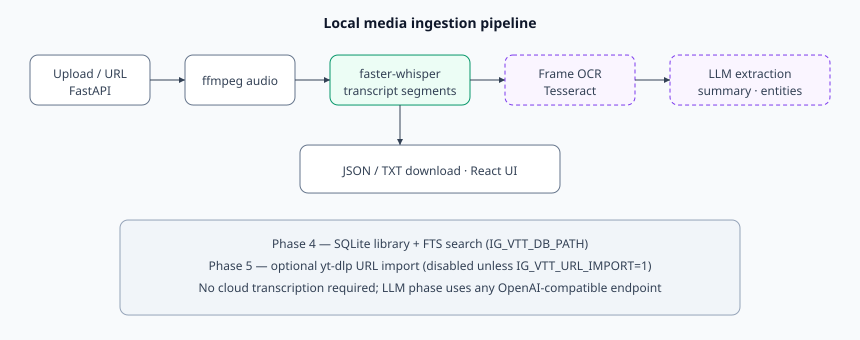

# IG Video to Text

## Business case

Short-form and social video is now a primary format for **training, marketing, and field knowledge**, but the information inside it is **not searchable, quotable, or integrable** with downstream workflows (briefs, CRM notes, research libraries). Teams either manually re-watch content or send sensitive media to third-party transcription APIs with unclear data handling.

This project addresses that gap with a **sovereign-by-default pipeline**: extract speech and on-screen text on infrastructure you control, optionally structure it into summaries and entities, and persist results in a **local searchable library**. File upload is the recommended path because platform URL scraping is fragile and often conflicts with terms of service. **Intent:** prove **multimodal ingestion without mandatory cloud STT**—a building block for creators, analysts, and compliance-minded orgs evaluating local ML stacks.

**Stack:** FastAPI · React (Vite) · faster-whisper · SQLite library · FTS search  
**License:** [MIT](LICENSE)  
**Topics:** `whisper` · `ffmpeg` · `ocr` · `fastapi` · `local-ml`

---

## Overview

Partners evaluating **multimodal ingestion on sovereign infrastructure** should start here: the default path keeps speech-to-text entirely local. Phase 2 extraction is optional and points at Ollama, Groq, or OpenAI via a compatible base URL. A built-in **library** (SQLite + FTS) supports search across past transcripts.

Roadmap detail: [ROADMAP.md](ROADMAP.md).

---

## Media pipeline workflow

<p align="center">
  
</p>

---

## Prerequisites

| Requirement | Notes |
|-------------|--------|
| Python 3.11+ | Backend API |
| Node.js 18+ | Frontend dev server |
| ffmpeg | On `PATH` |
| Tesseract | Optional; set `IG_VTT_TESSERACT_CMD` on Windows if needed |
| GPU | Optional; set `WHISPER_DEVICE=cuda` |

---

## Quick start

### Backend

```bash
git clone https://github.com/hfuenzalida/ig-video-to-text.git
cd ig-video-to-text/backend
python -m venv .venv
source .venv/bin/activate   # Windows: .venv\Scripts\activate
pip install -r requirements.txt
uvicorn main:app --reload --host 127.0.0.1 --port 8000
```

Health: `GET http://127.0.0.1:8000/api/health` — expect `ffmpeg: true` when ffmpeg is installed.

### Frontend

```bash
cd frontend
npm install
npm run dev
```

Open `http://localhost:5173`, upload a short `.mp4` / `.webm` / `.mov`, click **Transcribe**.

---

## Key environment variables

| Variable | Default | Meaning |
|----------|---------|---------|
| `WHISPER_MODEL` | `base` | `tiny`, `base`, `small`, … |
| `WHISPER_DEVICE` | `cpu` | `cpu` or `cuda` |
| `IG_VTT_MAX_UPLOAD_MB` | `500` | Upload cap |
| `IG_VTT_LLM_BASE_URL` | _(empty)_ | OpenAI-compatible API for Phase 2 |
| `IG_VTT_LLM_MODEL` | `llama3.2` | Chat model name |
| `IG_VTT_OCR_LANG` | `eng` | Tesseract languages, e.g. `eng+spa` |
| `IG_VTT_DB_PATH` | `backend/data/library.db` | Library database |
| `IG_VTT_URL_IMPORT` | off | Set `1` to enable `POST /api/transcribe/url` |

---

## API surface (selected)

| Endpoint | Description |
|----------|-------------|
| `POST /api/transcribe` | File upload + optional `ocr_interval`, `save_library` |
| `POST /api/transcribe/url` | yt-dlp import (host allowlist; compliance is your responsibility) |
| `GET /api/library/search?q=` | FTS search across saved transcripts |
| `GET /api/library/{video_id}` | Fetch stored job |

Use **Upload file** when platform terms or auth make URL import fragile.

---

## Project layout

```
backend/          FastAPI app, whisper, OCR, extract, library_db
frontend/         Vite + React operator UI
docs/workflows/   Architecture SVG diagrams
ROADMAP.md        Product phases
```

---

## Compliance note

URL import uses **yt-dlp**. Many social platforms restrict automated download; you must comply with **platform terms** and applicable law. Prefer local file upload for production demos shown to partners.

---

## Related portfolio repositories

| Repository | Focus |
|------------|--------|
| [fhir-interop-hub](https://github.com/hfuenzalida/fhir-interop-hub) | Healthcare · FHIR |
| [rag-retail-analyst](https://github.com/hfuenzalida/rag-retail-analyst) | RAG · retail |
| [security-suite-orchestrator](https://github.com/hfuenzalida/security-suite-orchestrator) | DevSecOps |
| [digital-brain](https://github.com/hfuenzalida/digital-brain) | Business OS |
| [ai-3-layer-coder](https://github.com/hfuenzalida/ai-3-layer-coder) | AI routing |